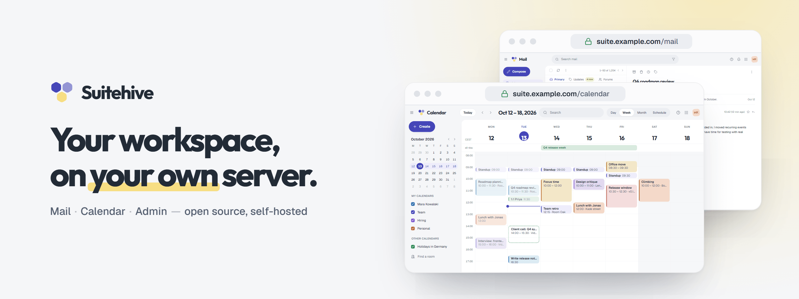

  

**Suitehive is an open-source, self-hostable alternative to Google Workspace.**
Mail, Calendar and single sign-on for your team, on your own domain and your own server.

It speaks the standards your apps already know (**IMAP, SMTP, CalDAV, OpenID Connect**), so Thunderbird,
Apple Mail and your phone keep working. One command installs the whole thing on a small VM.

> **Status: early development.** It runs end to end, but it's not production-ready yet and container
> images aren't published. Star or watch to follow along.

### What's inside

| | |
|---|---|
| 📬 **Mail** | Real SMTP in and out, IMAP for desktop and phone apps, DKIM/SPF/DMARC, labels and Gmail-style search, a phishing check on deceptive links, a built-in PDF viewer |
| 📅 **Calendar** | Recurring events that stay right across daylight saving, invitations in and out, find-a-time, rooms, sharing, CalDAV sync |
| 🔐 **Sign-in & Admin** | One account for every app, 2-step sign-in with passkeys, app passwords for mail clients, an admin console for users, groups, domains, roles and the audit log |
| 🖥️ **Self-hosting** | `suitehive` CLI for install, upgrade, backup and DNS checks. About 400 MB of RAM at idle; 2 vCPU / 4 GB is plenty for a small team |

### Repositories

| Repo | What it is |
|---|---|
| [**suitehive**](https://github.com/Suitehive/suitehive) | Start here: installer, `suitehive` CLI, product overview |
| [website](https://github.com/Suitehive/website) | Website and documentation |
| [auth](https://github.com/Suitehive/auth) · [mail](https://github.com/Suitehive/mail) · [calendar](https://github.com/Suitehive/calendar) | The apps: Go services with their web UIs |
| [kit](https://github.com/Suitehive/kit) · [contracts](https://github.com/Suitehive/contracts) · [ui](https://github.com/Suitehive/ui) | Shared Go library, API and event contracts, design system |
| [architecture](https://github.com/Suitehive/architecture) · [deploy](https://github.com/Suitehive/deploy) | Design docs, local dev environment |

Built with Go, PostgreSQL, NATS, React and TypeScript.

### Roadmap

Now: Mail, Calendar, Sign-in & Admin. Next: Contacts, Drive, Docs/Sheets/Slides, Chat.

### Get involved

Ideas, questions and bug reports are welcome. Read the [contributing guide](https://github.com/Suitehive/.github/blob/main/CONTRIBUTING.md)
before your first pull request, and report security issues privately as described in our
[security policy](https://github.com/Suitehive/.github/blob/main/SECURITY.md).
